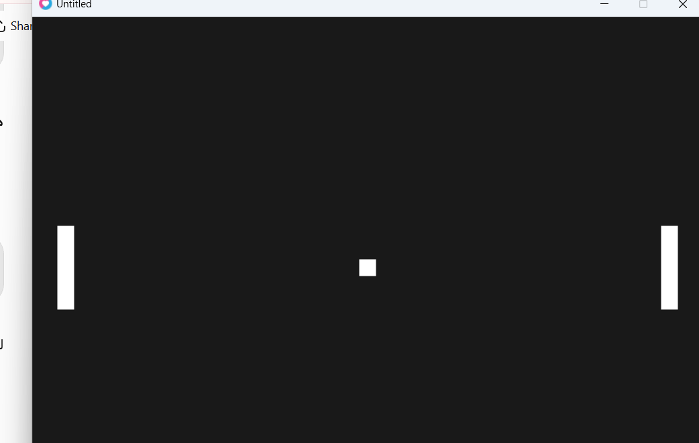
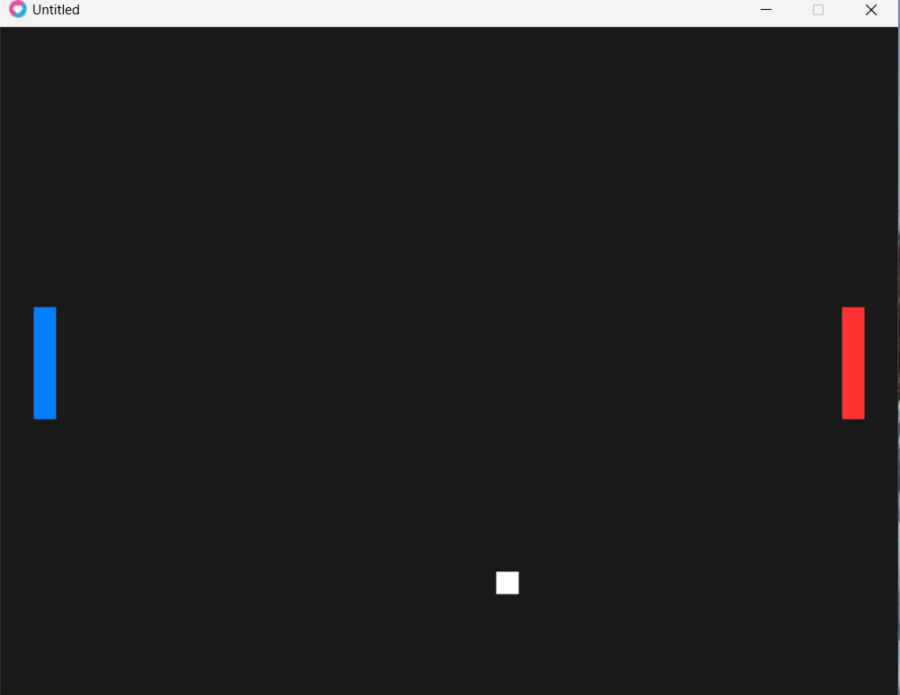

# Pong Game - Love2D

## Student Information
- **Full Name:** Wijdan Bashar Qamhawi
- **Student ID:** 12217661
- **Class:** Monday & Wednesday, 8:00–10:00
- **Section:** To be confirmed

## Game Description
This project is a simple two-player Pong game developed using Lua and the Love2D framework. The game includes two paddles controlled by the keyboard and a moving ball. The ball bounces off the top and bottom walls and changes its horizontal direction when it collides with a paddle. Paddle movement and ball movement use delta time (dt) to maintain consistent speed across different computers. Rectangle collision detection (AABB) is used to detect collisions between the ball and the paddles.

## How to Run
1. Install Love2D.
2. Open the project folder in a terminal.
3. Run the following command:

   `love .`

## Controls
- **W:** Move the left paddle up.
- **S:** Move the left paddle down.
- **Up Arrow:** Move the right paddle up.
- **Down Arrow:** Move the right paddle down.

## My Own Change
I added different colors to the two paddles to make them easier to distinguish. The left paddle is blue, the right paddle is red, and the ball remains white.

## Screenshots

### Game Screenshot 1

### Game Screenshot 2

## Demo Video

## Demo Video

[Watch Pong Game Demo](https://drive.google.com/file/d/1At7VD87S71ikT4poRCmvtSODcYVYzj-2/view?usp=sharing)
